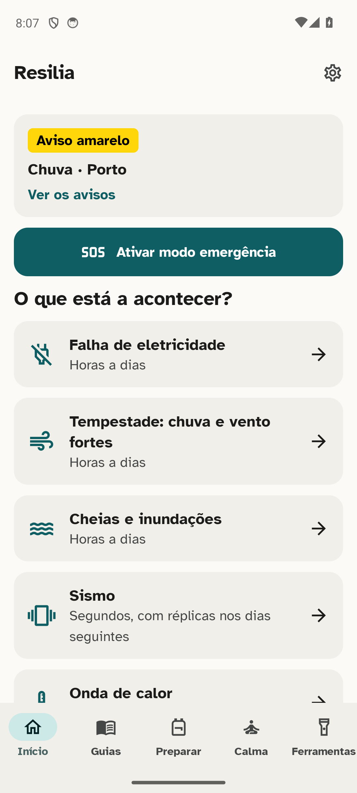
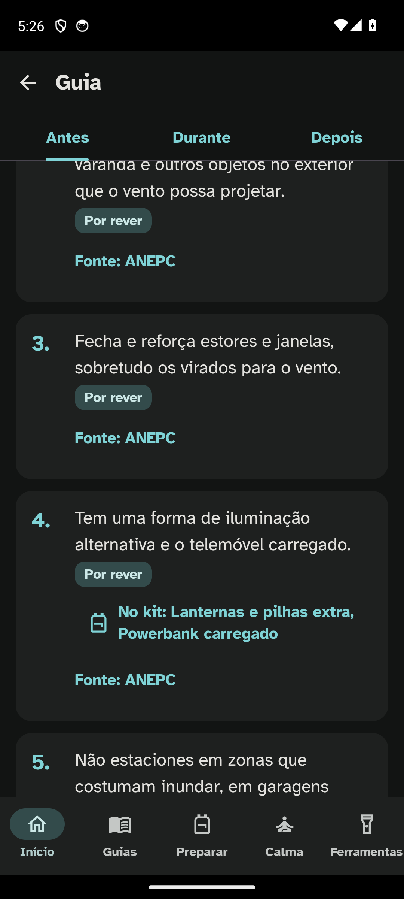
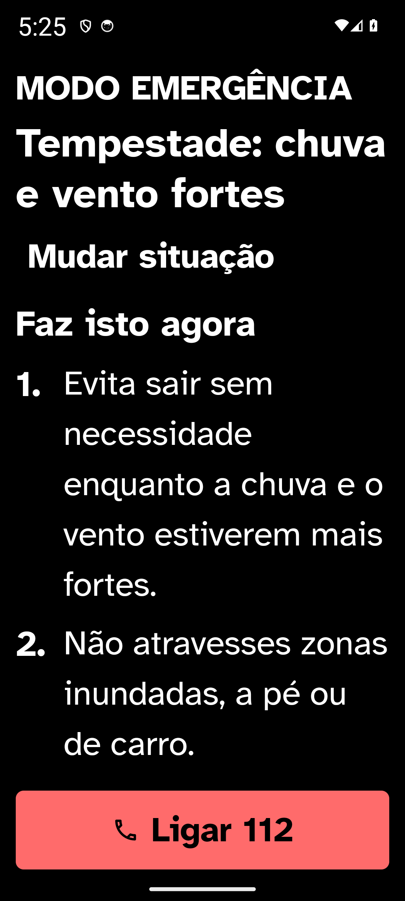
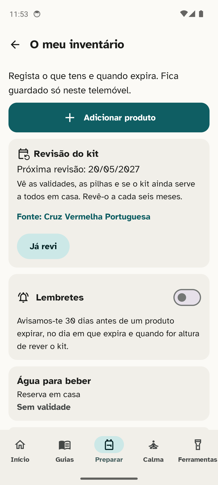
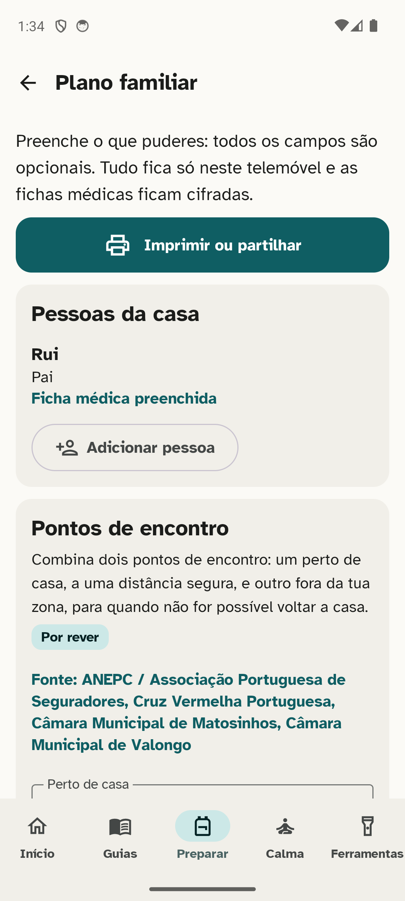
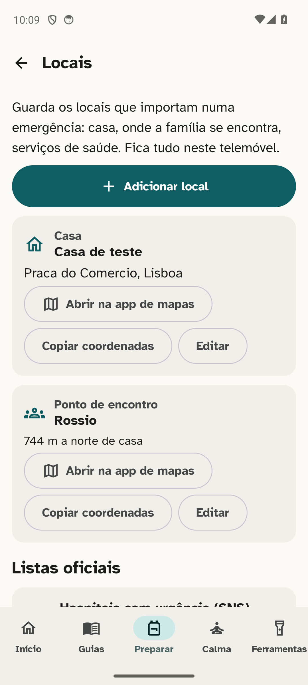
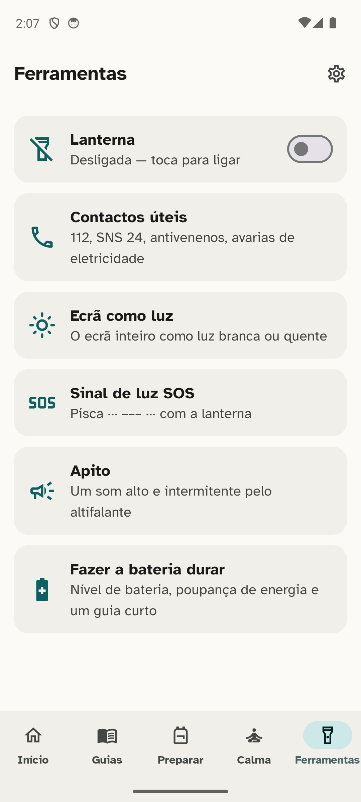
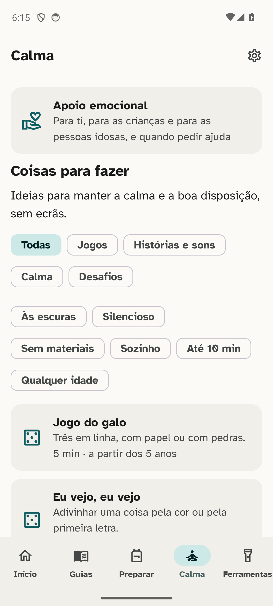

# Resilia

App Android gratuita e de código aberto para **preparação e resposta a emergências** em Portugal.
Funciona sem internet, não tem conta, nem anúncios, nem rastreio.

> ⚠️ Em emergência, liga **112**. Esta app não substitui os serviços de emergência nem aconselhamento profissional.

*English summary below.*

## Instalar

Enquanto a app não está na Google Play, podes instalar o APK diretamente:

**[⬇️ Descarregar resilia.apk](https://github.com/goncalogoncalves/resilia/releases/latest/download/resilia.apk)** (Android 8 ou mais recente · [todas as versões](https://github.com/goncalogoncalves/resilia/releases))

1. Abre a ligação no telemóvel e descarrega o ficheiro.
2. Abre-o. O Android pede para autorizar a instalação a partir do navegador: aceita só para esta instalação.
3. Para atualizar, descarrega a versão nova e instala por cima. Os teus dados mantêm-se.

O APK é compilado a partir deste repositório e assinado sempre com a mesma chave. Na página de cada versão está o SHA-256 do ficheiro, para confirmares que não foi alterado.

## Capturas

<p>








</p>

## Estado

Em desenvolvimento, por marcos. Ver [docs/marco-0-proposta.md](docs/marco-0-proposta.md) para a visão, as decisões e o plano.

| Marco | Estado |
|---|---|
| 0 — Proposta | ✅ |
| 1 — Estrutura, tema, navegação, dois modos, CI, validação de conteúdo | ✅ ([relatório](docs/marco-1-relatorio.md)) |
| 2 — Motor de conteúdo, falha de eletricidade, contactos úteis | ✅ ([relatório](docs/marco-2-relatorio.md), [fontes](docs/marco-2-fontes.md)) |
| 3 — Calculadora de kit, inventário, lembretes de validade, revisão semestral | ✅ ([relatório](docs/marco-3-relatorio.md), [fontes](docs/marco-3-fontes.md)) |
| 4 — Plano familiar (ficha médica cifrada) e PDF (A4, carteira, caderno de guias) | ✅ ([relatório](docs/marco-4-relatorio.md), [fontes](docs/marco-4-fontes.md)) |
| 5 — Ferramentas (ecrã-luz, SOS, apito, bateria) e guia de poupança de bateria | ✅ ([relatório](docs/marco-5-relatorio.md), [fontes](docs/marco-5-fontes.md)) |
| 6a — Cenários: tempestade, cheias, sismo (com tsunami), calor, frio e incêndio rural | ✅ ([relatório](docs/marco-6-relatorio.md), [fontes](docs/marco-6-fontes.md)) |
| 6b — Calma: apoio emocional, 24 atividades sem ecrã, filtros e "Algo para fazer" no modo emergência | ✅ ([relatório](docs/marco-6b-relatorio.md), [fontes](docs/marco-6b-fontes.md)) |
| 7 — Avisos IPMA (meteorológicos e risco de incêndio), notificações e sugestão do modo emergência | ✅ ([relatório](docs/marco-7-relatorio.md), [fontes](docs/marco-7-fontes.md)) |
| 8a — Locais (os meus locais, hospitais com urgência do SNS, modo emergência, cartão A4); mapa offline decidido no [ADR 0001](docs/adr/0001-mapa-offline.md) | ✅ ([relatório](docs/marco-8-relatorio.md), [fontes](docs/marco-8-fontes.md)) |
| 9a — Acessibilidade (auditoria a 200 % e modo escuro), exportar/importar cifrado, idioma, privacidade, ligações ao kit, ícone e imagens da loja | ✅ ([relatório](docs/marco-9a-relatorio.md), [fontes](docs/marco-9-fontes.md)) |
| 9b — Preparação da publicação: assinatura, App Bundle, política de privacidade, guia e ficha da loja | 🟡 por aprovar ([relatório](docs/marco-9b-relatorio.md), [guia](docs/publicacao.md)) |
| 8b — Mapa offline | — |

## Princípios

- **Offline-first**: todo o conteúdo essencial vem dentro da app. A rede só serve para ler os avisos do IPMA.
- **Sem conta, sem servidor, sem analytics**. Os dados ficam no telemóvel e são excluídos dos backups na cloud.
- **Permissões mínimas**. A lanterna não pede acesso à câmara; "Ligar 112" abre o marcador sem pedir permissão de chamadas.
- **Utilizável sob stress**: letra grande (Atkinson Hyperlegible), alto contraste, passos curtos e numerados.
- **Honestidade**: conteúdo de saúde e segurança só com fontes oficiais, indicadas em cada passo. O aviso legal diz que os textos não foram revistos por profissionais.

## Estrutura

```
app/                 Activity, navegação, escolha do modo (aviso legal / normal / emergência)
core/domain          Kotlin puro: modelos e interfaces (pronto para Kotlin Multiplatform)
core/content         Leitura e regras do conteúdo JSON (Kotlin puro)
core/data            Android: assets, DataStore, lanterna
core/designsystem    Tema normal e de emergência, componentes acessíveis
feature/*            Um módulo por área (home, guides, emergency, prepare, morale, tools, settings)
content/             Conteúdo educativo (JSON): guias, fontes, contactos, kit, plano familiar, guia da bateria, atividades, áreas de aviso do IPMA + schemas — copiado para a app no build
tools/content-validator  Validação do conteúdo (corre no CI)
tools/data           Scripts que geram conteúdo a partir de dados abertos oficiais (ex.: urgências do SNS)
tools/store          Script que gera o ícone de 512 px e a imagem de destaque da Google Play
build-logic/         Plugins Gradle partilhados
```

## Compilar

Requisitos: JDK 17 e Android SDK (o Gradle instala a plataforma necessária).

```
./gradlew :app:assembleDebug                         # APK de debug
./gradlew test testDebugUnitTest                     # testes (inclui UI com Robolectric)
./gradlew :tools:content-validator:validateContent   # valida /content
./gradlew lintDebug
```

## Licenças

- Código: [Apache License 2.0](LICENSE)
- Conteúdo (`/content`, textos dos guias): [CC BY-SA 4.0](LICENSE-CONTENT)
- Tipo de letra Atkinson Hyperlegible: SIL Open Font License 1.1 ([core/designsystem/OFL-AtkinsonHyperlegible.txt](core/designsystem/OFL-AtkinsonHyperlegible.txt))

---

## English summary

Resilia is a free, open-source Android app that helps people in Portugal prepare for and respond to
emergencies (power outages, water outages, floods, fires, earthquakes, storms, heatwaves, cold spells,
evacuation). It works offline, has no account, ads or tracking, and is available in Portuguese (pt-PT)
and English. Code is Apache-2.0; content is CC BY-SA 4.0. See [CONTRIBUTING.md](CONTRIBUTING.md).

Until it is on Google Play, you can [download the APK](https://github.com/goncalogoncalves/resilia/releases/latest/download/resilia.apk) (Android 8+). The SHA-256 is on each [release page](https://github.com/goncalogoncalves/resilia/releases).
